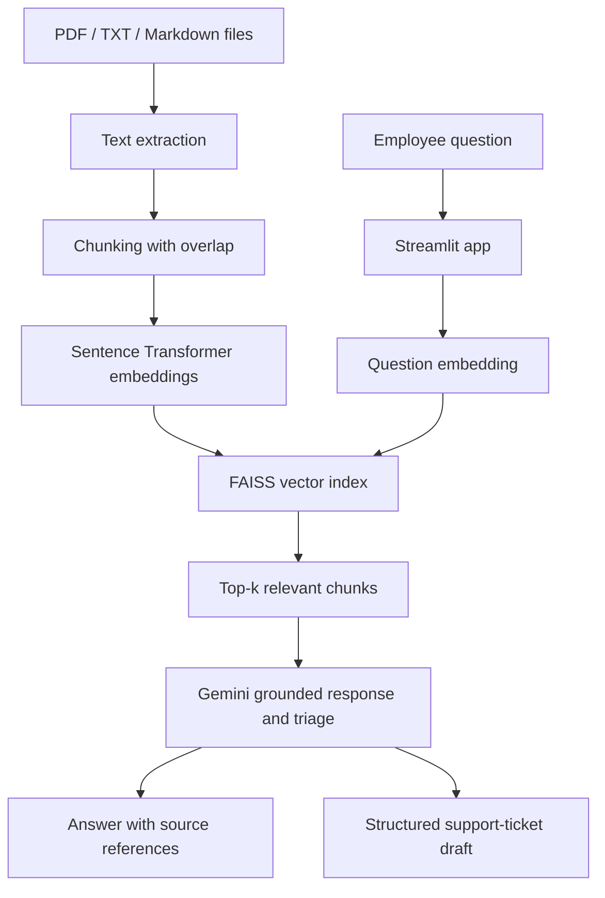

# ServiceDesk GenAI Copilot

An enterprise-style IT support assistant built with Retrieval-Augmented Generation (RAG). Employees can ask questions about uploaded IT policies and troubleshooting guides. The application retrieves evidence from the knowledge base, uses Gemini to draft a grounded response, classifies the request, estimates priority, and prepares a downloadable support-ticket draft when escalation is appropriate.

> **Portfolio/demo project:** The supplied handbook is fictional. Ticket drafts are generated locally in the app and are not submitted to Jira, ServiceNow, or another live ticketing platform. Do not upload confidential company documents or personal data to a public demo.

## Features

- Upload multiple PDF, TXT, and Markdown knowledge documents.
- Extract PDF text with page-level source metadata.
- Split documents into overlapping text chunks.
- Generate local sentence-transformer embeddings.
- Store and retrieve normalized vectors with FAISS.
- Generate context-grounded answers with the Gemini API.
- Classify requests by category, priority, and sentiment.
- Flag unsupported or sensitive requests for human escalation.
- Show retrieved source documents, page numbers, and similarity scores.
- Prepare structured JSON support-ticket drafts for download.
- Keep chat and ticket drafts in Streamlit session state.

## Architecture



## Tech stack

- Python 3.11
- Streamlit
- Google Gen AI Python SDK (Gemini Developer API)
- Sentence Transformers (`all-MiniLM-L6-v2`)
- FAISS (`IndexFlatIP` with normalized embeddings)
- LangChain Text Splitters
- pypdf
- pytest

## Repository structure

```text
servicedesk-genai-copilot/
├── app.py
├── requirements.txt
├── README.md
├── .gitignore
├── .streamlit/
│   ├── config.toml
│   └── secrets.toml.example
├── sample_docs/
│   └── company_it_handbook.md
├── src/
│   ├── __init__.py
│   ├── agent.py
│   ├── config.py
│   ├── retrieval.py
│   └── ticketing.py
└── tests/
    ├── test_agent.py
    └── test_ticketing.py
```

## 1. Prerequisites

- Python 3.11
- Git
- A GitHub account
- A Gemini API key from [Google AI Studio](https://aistudio.google.com/apikey)

## 2. Run locally (Windows PowerShell)

```powershell
py -3.11 -m venv .venv
.\.venv\Scripts\Activate.ps1
python -m pip install --upgrade pip
pip install -r requirements.txt
```

If PowerShell blocks activation, run the following in Command Prompt instead:

```bat
.venv\Scripts\activate.bat
```

Create `.streamlit/secrets.toml` by copying `.streamlit/secrets.toml.example`, then replace the placeholder with your own key:

```toml
GEMINI_API_KEY = "your-real-api-key"
```

Never commit `.streamlit/secrets.toml`. It is excluded by `.gitignore`.

Run the app:

```bash
streamlit run app.py
```

Open the local URL shown in the terminal (normally `http://localhost:8501`). In the sidebar, upload the included `sample_docs/company_it_handbook.md` or your own non-confidential support documents, then click **Build / refresh knowledge base**.

## 3. Run tests

```bash
python -m pytest -q
```

The included unit tests validate JSON response parsing, safe metadata defaults, and support-ticket draft creation. They do not call the Gemini API or download the embedding model.

## 4. Upload to GitHub

Create a new **public** repository named `servicedesk-genai-copilot` under your GitHub account. Do not initialize it with another README if you are pushing this local project.

```bash
git init
git add .
git status
git commit -m "Build ServiceDesk GenAI Copilot with RAG and Gemini"
git branch -M main
git remote add origin https://github.com/ramGit2026/servicedesk-genai-copilot.git
git push -u origin main
```

Before `git push`, inspect `git status` and confirm `.streamlit/secrets.toml` is not listed. If Git says the remote already exists, inspect it with `git remote -v` rather than adding another remote.

Expected repository URL after you create it and push the files:

https://github.com/ramGit2026/servicedesk-genai-copilot

## 5. Deploy to Streamlit Community Cloud

1. Push the project to GitHub first.
2. Sign in at [Streamlit Community Cloud](https://share.streamlit.io/) using GitHub.
3. Choose **Create app** and select `ramGit2026/servicedesk-genai-copilot`.
4. Select branch `main` and main file path `app.py`.
5. In Advanced settings, select Python 3.11 if available.
6. In the Secrets field, add:

   ```toml
   GEMINI_API_KEY = "your-real-api-key"
   ```

7. Deploy and check the app logs if startup fails.

The app downloads the sentence-transformer model the first time it runs. The first launch may take longer than later launches. Keep documents small enough for the available cloud memory and upload limits.

## How the RAG workflow works

1. **Ingestion:** read PDF pages or decode TXT/Markdown files.
2. **Chunking:** split text into 900-character chunks with 150-character overlap.
3. **Embedding:** convert each chunk into a normalized vector using `all-MiniLM-L6-v2`.
4. **Indexing:** add vectors to a FAISS inner-product index. With normalized vectors, inner product ranks cosine similarity.
5. **Retrieval:** embed the employee question and retrieve the top five chunks.
6. **Generation:** pass relevant evidence to Gemini with instructions to avoid unsupported claims and ignore instructions embedded in source documents.
7. **Triage:** return answer, category, priority, sentiment, escalation flag, recommended actions, and ticket summary as structured JSON.
8. **Handoff:** prepare a downloadable JSON ticket draft for a human service-desk agent.

## Evaluation and limitations

- The similarity score is a retrieval-ranking signal, not a calibrated probability or guaranteed measure of answer correctness.
- The relevance cutoff is a configurable heuristic in `src/config.py`; tune it against a representative evaluation set.
- The initial version extracts text from PDFs. Scanned/image-only PDFs require OCR before ingestion.
- Conversation history and generated ticket drafts live in Streamlit session state; there is no durable database or multi-user identity management.
- The project does not create real tickets or access company systems. An actual integration would require an authenticated backend, authorization controls, audit logging, and a ticketing API.
- Use only synthetic, public, or approved documents in a public portfolio deployment.

## Future enhancements

- Integrate Jira Service Management or ServiceNow ticket creation.
- Add OCR for scanned PDFs.
- Add hybrid keyword + vector retrieval and a reranker.
- Add a persistent vector store and database-backed conversation history.
- Build a labelled evaluation set and measure retrieval recall, groundedness, and answer quality.
- Add authentication, role-based access, rate limits, and audit logs.

## Author

**Ramkumar**  
GitHub: [@ramGit2026](https://github.com/ramGit2026)
